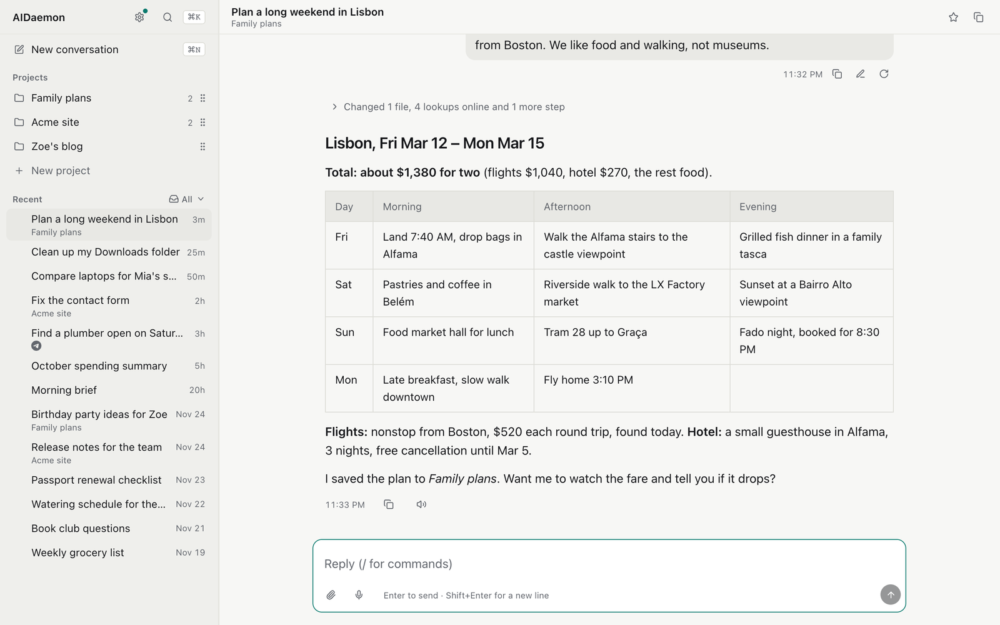
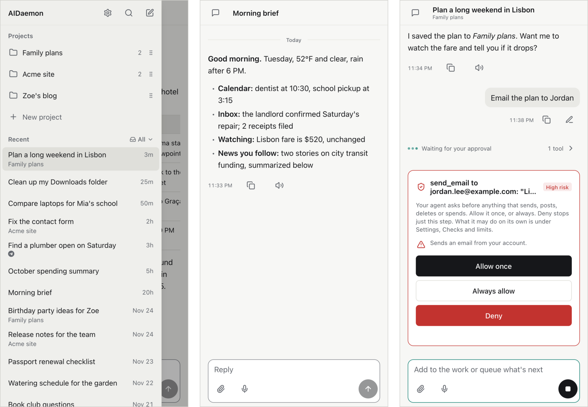
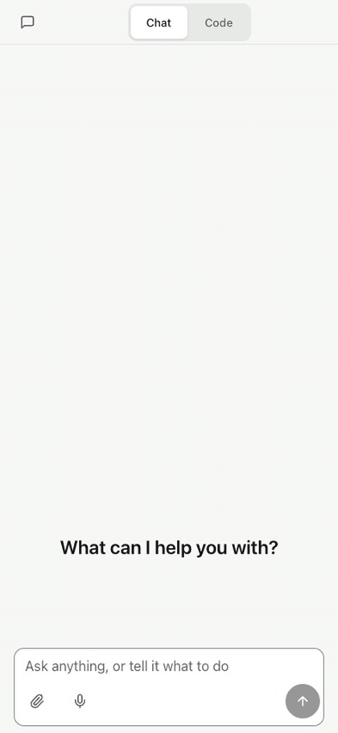
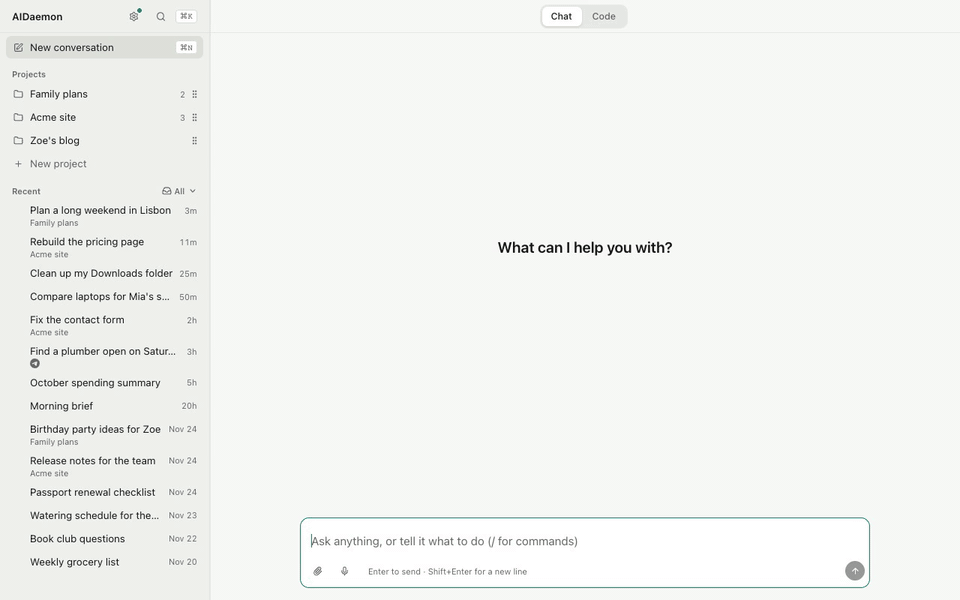
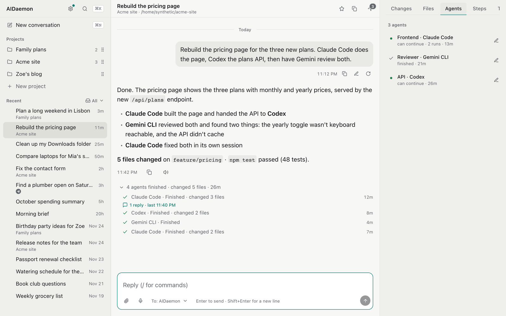
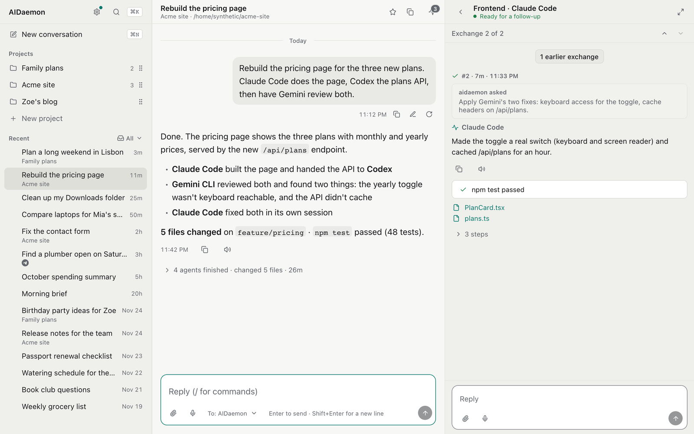
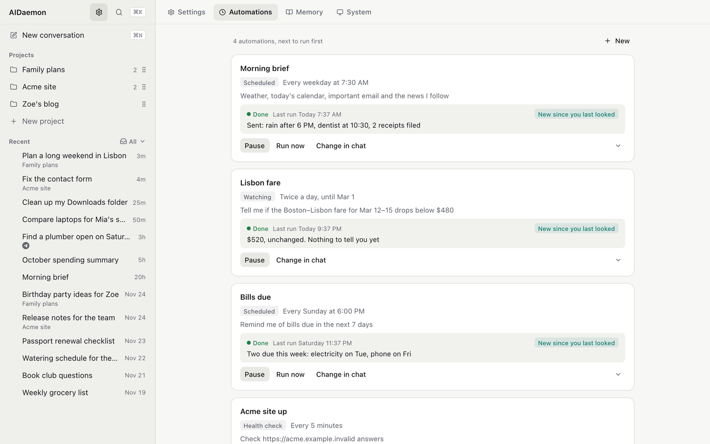

# AIdaemon

[](https://github.com/davo20019/aidaemon/actions/workflows/ci.yml)
[](https://crates.io/crates/aidaemon)
[](LICENSE)

[Website](https://aidaemon.ai/) · [Documentation](https://docs.aidaemon.ai/) · [Download](https://github.com/davo20019/aidaemon/releases/latest) · [Discord](https://discord.gg/JCCPtEEy) · [𝕏](https://x.com/aidaemon_ai)

**Your own AI agent. It runs on your computer, works while you're away, and you can reach it from anywhere.**

Ask it to plan a trip, clean up a folder, compare products, keep an eye on a price, write a morning brief, or fix a bug in your code. It looks things up, runs programs, uses a real browser, remembers what matters to you, and asks before it sends, posts, deletes or spends anything. Talk to it in the AIdaemon app on your Mac, Windows or Linux computer, phone or browser, or in Telegram, Slack and Discord. Your phone reaches it from anywhere with no tunnel, port forwarding, VPN or account: scan a QR code and you're connected.

<picture>
  <source media="(prefers-color-scheme: dark)" srcset=".github/readme/chat-dark.png">
  
</picture>

## Not only for developers

Most AI agents live in a terminal. AIdaemon has an app anyone can use: install it, sign in to the AI you already pay for (a ChatGPT plan works, no API key needed), and start asking. The same agent then follows you to your phone.



<p align="center"><br><sub>Recorded in the app with a scripted demo agent and synthetic data.</sub></p>

A few things people ask it for:

- "Plan a 3-day weekend in Lisbon under $1,500, flights from Boston." Then "watch the fare and tell me if it drops."
- "My Downloads folder is a mess. Clean it up, but ask before deleting anything."
- "Every weekday at 7:30, send me the weather, my calendar and the news I follow."
- "Compare three laptops for my daughter's school, under $900."
- "The contact form on our site sends nothing. Fix it and run the tests."

## What makes it different

- **It's yours.** It runs on your own computer or server, with your accounts. Your conversations, memory and files stay there; what goes out is the calls to the AI model you choose and whatever a task you asked for needs, such as a search.
- **Reach it from anywhere. No tunnels.** Pair your phone by scanning a QR code, and that's the whole setup: no tunnel, port forwarding, VPN, domain or account. The app connects straight to your computer when the network allows, and through an encrypted relay otherwise (the project's own by default, or yours). It's end-to-end encrypted, so the relay never sees what you say. Or message it on Telegram, Slack or Discord.
- **It does the work, not just the talking.** It runs commands, edits files, uses git, browses the web in a real browser you can watch and take over, calls APIs, connects MCP servers, and on a Mac can operate your apps for you.
- **Safe by design.** Anything that sends, posts, deletes, spends or runs a risky command waits for your OK on a card like the one above. When it has read something someone else wrote (a web page, an email, a stranger's message), every outward action it then tries is checked against only what *you* asked for, so text written to steer an AI agent can't make it act for someone else.
- **It remembers you.** It keeps durable facts about you, your projects and the people you mention, recalls past conversations by meaning, and keeps each project's notes in plain Markdown files you can read and edit. You can see and delete what it knows at any time.
- **It works on its own.** Scheduled automations run at set times; watching automations pursue a goal within limits you approve and tell you only when something changes. Each one shows what it does, how often, what it may do and when it ends.
- **Your coding agents work as a team.** Claude Code, Codex, Gemini CLI, GitHub Copilot CLI, Antigravity, OpenCode, Aider and any [Agent Client Protocol](https://agentclientprotocol.com) agent work under AIdaemon as a team: they hand work to each other (in separate git worktrees, or read-only for a review), AIdaemon pauses one that runs out of usage and hands its work to another, and shows every changed file, step and test run in the app.
- **Any model.** Use your ChatGPT plan, or an API key for Anthropic, OpenAI, Google Gemini, xAI, DeepSeek, Moonshot, MiniMax, OpenRouter or Cloudflare AI Gateway, or run models on your own hardware with Ollama, llama.cpp, LM Studio or vLLM. Fallbacks take over when one is down or out of quota.
- **One small program.** A single Rust binary: no Docker, Node.js or Python needed. It runs on a laptop, a Raspberry Pi or a cheap server, and it is open source under the MIT license.



<sub>Recorded in the app with a scripted demo agent and synthetic data.</sub>

## Quick start

**Mac:** download `AIdaemon-macos-aarch64.dmg` (Apple silicon) or `AIdaemon-macos-x86_64.dmg` (Intel) from the [latest release](https://github.com/davo20019/aidaemon/releases/latest), drag AIDaemon to Applications and open it. Until the download is notarized, macOS asks once: open it, then **System Settings → Privacy & Security → Open Anyway**.

**Windows:** download `aidaemon-windows-x86_64.zip` from the [latest release](https://github.com/davo20019/aidaemon/releases/latest), extract it to a folder you keep (for example `%LOCALAPPDATA%\AIDaemon`) and open `aidaemon-app.exe`. If SmartScreen warns about an unrecognized app: **More info → Run anyway**.

**Linux, or any machine with a terminal:**

```bash
curl -sSfL https://get.aidaemon.ai | bash
```

Or with Homebrew (`brew install davo20019/tap/aidaemon`) or Cargo (`cargo install --locked aidaemon`, the daemon only). Then run `aidaemon app` to open the app.

The first time it opens, the app starts AIdaemon on this computer (now and at login, with no administrator password). It finds an AI you already have (a ChatGPT sign-in, a provider key in your environment, Ollama or llama.cpp running locally) and offers it in one click, or connects the one you pick. Each is tested before anything is saved, and each says whether it uses your plan, bills per token or runs on your own machine. Your first conversation opens next. To reach it from your phone or from Telegram, Slack or Discord, open **Settings → Reach it from your phone**.

**Phone:** on Android, install `aidaemon-android.apk` from the [latest release](https://github.com/davo20019/aidaemon/releases/latest); on any phone, the web app works in the browser. In the desktop app, **Settings → Paired devices → Pair a phone** shows a QR code to scan.

**On a server:** over SSH, run `aidaemon setup` to connect a model, then `aidaemon service install` to keep it running. Run `aidaemon pair` for a QR code: your phone and laptop connect through the encrypted relay, with no tunnel or open port. (To set it up from a browser instead, run `aidaemon` with no config: it prints a link and a one-time code for its setup page on port 8788, which you reach through SSH port forwarding until it is set up.)

<details>
<summary>Self-hosted models: notes</summary>

Self-hosted models need no key: pick **Ollama (local)** or **llama.cpp (local)**, or **Another OpenAI-compatible service** with your server's address (LM Studio, vLLM) and the key left empty. `llama-server` and the daemon's health check both default to port 8080: start one of them elsewhere (`llama-server --port 8081`, or `[daemon] health_port`) and give llama.cpp's address in its form.
</details>

## Features

### The app
One app for Mac, Windows, Linux, iOS, Android, the browser and the terminal, where you see and steer everything:

- **Conversations and projects.** Chat about anything, or open a project (a folder or a repository) whose conversations share its notes, skills and tools.
- **Conversation details** show its Changes, Files, Steps, Terminal and Browser. The Terminal tab is that conversation's own shell on the daemon's computer, started in its folder; the agent can read it and type into it once you allow. The Browser tab shows the agent's browser live: take control, give it back, or point at something for it.
- **Messages sent while work runs** wait under "Waiting to send", where you can edit or remove them, or press **Send now** to give one to the running work.
- **Model and effort per conversation:** pick Auto or a model you pin, and Auto, Low, Medium or High effort.
- **Automations, Memory and System pages:** your automations as cards you pause or run now; what it remembers, which you can delete; and versions, the model and its fallbacks, how the app reaches the daemon, token use, background jobs, health checks, chat bots and paired devices.
- **`aidaemon share-screen`** shares a Mac's screen with your daemon elsewhere so you can watch and drive it from the app (`--pair <link>` the first time, with a link from `aidaemon pair`; needs the `computer_use-macos` build).

### Chat apps
Talk to it on **Telegram**, **Slack** (Socket Mode) or **Discord**. Run several bots; on Telegram, add new ones at runtime with `/connect`, no restart needed. Send pictures and it looks at them with a vision-capable model. Ask for an image and `generate_image` makes one (with a connected ChatGPT plan, whatever model the conversation runs on). Send voice notes: audio-capable models hear them directly; otherwise turn on local Whisper speech-to-text under `[files.stt]` (needs `whisper-cli`, a GGUF model, and `ffmpeg` for OGG/Opus). On Telegram, `/terminal` opens the hosted terminal Mini App with secure pairing, and `/agent [codex|claude|gemini|opencode] [dir]` starts a coding-agent session; `aidaemon attach <code>` continues it in a terminal on your computer, and `aidaemon share` makes a code to resume one from Telegram.

### Tools and agents
Dozens of built-in tools: terminal, files, git, a headless Chrome browser, web search, HTTP requests with saved auth profiles, MCP servers, images and more. Each tool declares what it does: reading runs freely, side effects ask first. Hand complex work to **sub-agents** or to **coding agents** (Claude Code, Codex, Gemini CLI, GitHub Copilot CLI, Antigravity, Aider, found automatically). Any other agent that speaks the [Agent Client Protocol](https://agentclientprotocol.com) works too: add it under `[cli_agents.tools.<name>]` with `protocol = "acp"`, and each action it takes is asked first.

`manage_api` connects an API from its OpenAPI spec or GraphQL schema and checks the connection safely. Credentials stay in the OS keychain.

### Coding agents as a team


Ask for a change and say who should do what ("Claude Code does the page, Codex the API, then have Gemini review"), or let AIdaemon decide. Each agent runs in its own session: in its own git worktree for parallel edits, or read-only for a review. Agents hand work to each other, check on one another and share a coordination board, so the work doesn't collide. The app shows every agent in the conversation's **Agents** tab under a name you give it ("Frontend", "Reviewer"). Open one to see what it was asked, what it answered, its checks, changed files and steps, and send it a follow-up that continues its own session. Each changed file opens its diff. An agent whose plan runs out of usage pauses until its usage resets, and its work goes to another agent meanwhile.



### Computer use (macOS)
Built with `--features computer_use-macos`, the agent can operate Mac apps: it reads an app's accessibility tree, takes a screenshot, and clicks, types and scrolls to finish a task. Off by default; setup and permissions in [COMPUTER_USE_MACOS.md](COMPUTER_USE_MACOS.md).

### Memory
Memory lives in an encrypted SQLite database with local vector embeddings (quantized AllMiniLM-L6-v2 by default; any fastembed model via `[memory] embedding_model`). Background consolidation turns conversations into durable facts. Past conversations are recalled by meaning, and `search_history` finds exact messages (kept 90 days by default, `state.retention.messages_days`; `0` keeps them for good). To keep one message out of memory, send `/private` first, or just ask it not to remember something.

**Project memory.** A conversation in a project (a Code conversation in the app, or a chat moved there with `/project`) keeps what it learns about that project in the project's own notes: Markdown files under `~/.aidaemon/projects/<project-id>/memory/` with a generated `MEMORY.md` index, outside the repository and kept by the project's id, so a rename or a moved folder keeps them. `remember_fact` takes `scope: "project" | "personal"`. Facts about you and the people around you always stay in personal memory. Turn it off with `[memory] project_memory = false`, or move it with `[memory] projects_dir`. A project conversation also gets the repository's own skills (`.agents/skills`, `.claude/skills`) and can start the MCP servers its `.mcp.json` declares, each only after you approve its exact command.

### Skills
Instructions that teach it new workflows, loaded when a task needs them or when you ask by name: from files, URLs or remote registries. A procedure that keeps working becomes a skill draft for you to review, approve or dismiss (`manage_skills review`).

### Automations
Everything that runs on its own is an automation. **Scheduled** ones run an instruction at set times, from natural-language schedules ("every weekday at 7:30"). **Watching** ones work toward an objective within limits you approve, deciding each time whether to act, wait, ask you or stop. Health checks watch a site, port, command or file. Email can trigger work through IMAP IDLE. Ask for what you want and the agent picks the kind; pause, resume or cancel any of them by name.



### Security
Approval cards for risky actions (Allow, Allow until restart or Always allow, Deny), the untrusted-content check described below, terminal allowlists, SSRF protection, secrets kept out of outgoing requests, an encrypted database, secrets in the OS keychain, and role-based access for other people in your chats. The database key lives in the OS keychain (on a machine without one, such as a headless Linux server, it stays in an owner-only `.env` beside the database, so keep backups of that folder private). Release downloads are signed with ed25519 (`<file>.sig`, key in `scripts/release-signing-key.pub.pem`); self-update installs only a signed release. Details: [security docs](https://docs.aidaemon.ai/).

## Running as a service

```bash
aidaemon service install      # this user, at login, from ~/.aidaemon (--dir to change); starts it now
aidaemon service uninstall
```

This is what the app's **Run it here** does: a launchd agent on macOS, a systemd user unit on Linux (lingering is turned on so it outlives your login session), a logon task on Windows. `aidaemon install-service` still writes the system-wide unit (Linux, needs sudo) or the launch agent without starting it (macOS).

### Other commands

`aidaemon --help` lists them all. Besides the ones above:

| Command | What it does |
|---|---|
| `aidaemon app` / `tui` / `web` | Open the app in a window, in this terminal, or in the browser |
| `aidaemon pair` | Pair a phone or browser (QR code or code) |
| `aidaemon client-token` | Mint a new local Client Gateway token (revokes the old one) |
| `aidaemon node <command>` | Pair, inspect, authorize or revoke Nodes |
| `aidaemon share-screen` | Share this Mac's screen with your daemon (see The app) |
| `aidaemon browser login` | Open Chrome to sign in to services the agent will use |
| `aidaemon agent start <agent>`, `codex`, `claude`, `gemini`, `opencode` | Start a coding agent through aidaemon |
| `aidaemon attach <code>` / `share [session_id]` | Continue a Telegram `/agent` session here, or make a code to resume one there |
| `aidaemon keychain set\|get\|delete <key>` | Manage a secret in the OS keychain |
| `aidaemon memory-export DIR` | Write a readable copy of memory to a new directory |
| `aidaemon setup low-latency` | Set up Telegram's webhook low-latency mode |
| `aidaemon migrate` | Run database migrations and exit |
| `aidaemon check-update` | Check for a newer release |

## Configuration

All settings live in `config.toml`, written by first-run setup and editable from the app's Settings page. See [`config.toml.example`](config.toml.example) for the full reference and the [documentation](https://docs.aidaemon.ai/) for guides on each feature. The provider config supports model-level fallbacks on the primary backend and ordered cross-provider fallbacks via `[[provider.fallbacks]]`. The sections below are the reference for the parts people ask about most.

<details>
<summary><b>Execution environments</b></summary>

By default, agent-visible files and commands run locally with the same behavior
as earlier releases. You can instead put the entire workspace behind a
persistent Docker container or an SSH host:

```toml
[execution]
backend = "local" # local | docker | ssh
# workspace_root = "/absolute/path/to/workspace"
# allow_outside_workspace = true # path tools: true locally, false remotely
```

Filesystem tools, terminal commands, Git operations, CLI agents, attachments,
and generated result files all use the selected backend. This keeps the model
on one coherent filesystem. Configuration, encrypted state, channel transport,
credentials, approvals, and browser/computer-use sessions remain on the daemon
host.

The Docker backend is built in (the `execution-docker` feature, on by
default; it drives the `docker` CLI and adds no dependencies), so Docker is
needed only when `[execution] backend = "docker"` is set. The Docker backend creates or reuses one persistent container and defaults to
no network access. The SSH backend uses the local OpenSSH client and honors
existing host aliases, ssh-agent, ProxyJump, known-host, and hardware-key
configuration. `allow_outside_workspace` confines path-based tools and command
working directories; shell commands still have the permissions of the
selected local/SSH account or container and remain subject to terminal
approval. Persistent terminal approvals are scoped to the concrete execution
target. See [`config.toml.example`](config.toml.example) for complete Docker and
SSH examples.

</details>

<details>
<summary><b>Workspace source checkpoints</b></summary>

For remotely operated agents, the local execution backend can create a
conflict-aware source checkpoint before the first workspace mutation in each
turn:

```toml
[execution]
backend = "local"
workspace_root = "/absolute/path/to/project"
allow_outside_workspace = false

[checkpoints]
enabled = true
```

Checkpoints use a bare shadow-Git object store in aidaemon's platform data
directory. They never modify the project's `.git` directory, index, or
working-tree metadata. `.env*` secrets (except example/template files), keys,
credentials, dependencies, build outputs, caches, logs, special files, and
oversized files are excluded; project `.gitignore` rules are respected.

Owners can use `/checkpoints` or the read-only `list_checkpoints` tool to list
them. `/rollback <id>` produces a conflict preview and short-lived confirmation
token; `/rollback confirm <token>` restores only paths still matching the
agent's finalized post-turn tree. Independently changed paths are preserved,
and a safety checkpoint is taken before rollback.

This beta is local-backend only. Raw terminal/agent bridge sessions are not
covered, and checkpoints involving detached/background mutation are marked
unsafe rather than offered for rollback. The external object store is
owner-readable and contains plaintext copies of eligible source files; use
retention and size limits appropriate for the machine.

</details>

<details>
<summary><b>Authority and untrusted content</b></summary>

Pages, emails, other people's messages and files outside your own folders can
contain text written to steer an AI agent. aidaemon tracks this. Once a turn
has read content someone else wrote, any outward action it then tries (sending
a message or email, posting, calling a remote API with your credentials,
deleting outside your folders, changing configuration, running an unknown
program on the host) is first checked by a separate model call that sees only
your request and the proposed action, never the content that was read. If the
action is not something your request asked for, it is refused and the agent
is told why. Reading, editing files in your workspace and ordinary local work
such as builds, tests and local git commits are not checked. Results from
helper agents carry the same mark, and a chat stays marked while the turn that
read the content is still in its context.

```toml
[authority]
owner_default = "full"   # read_only | full (Standard) | full_access
# Your own folders: reading files here does not count as untrusted content.
trusted_roots = ["~/projects"]
```

`owner_default` is AIdaemon's permission level, the most it, its helper
agents and every coding agent it starts may do. **Read only** allows only
tools that read. **Standard** (`full`, the default) allows every tool and
asks before risky terminal commands. **Full access** runs every terminal
command without asking; `/trustall on` and `/trustall off` switch it, as
does Settings → AIdaemon permissions in the app. Lowering the level applies
at once. Raising it to Full access is approved on another paired device, or,
with none, by sending `/trustall on confirm`. Each coding agent follows the
level ("Same as AIdaemon") or a stricter mode you pick under
`[cli_agents.permissions]`; a mode above the level runs at the most the level
allows. Older settings move into this key at startup without widening
anything: trust-all becomes `full_access`, and `owner_default =
"unrestricted"` becomes `full` (or `full_access` if trust-all was on).

Your own folders are only the ones you grant on purpose: `[authority]
trusted_roots`, the daemon's working directory, a scheduled goal's workspace
set with `bind_workspace`, and a group chat's workspace grant. Path aliases
(`[path_aliases] projects`) only help aidaemon find projects by name; they do
not grant trust, so add a folder to `trusted_roots` if you want it trusted.
A folder named only in a message or a goal's mission (for example "summarize
~/Downloads/invoice.pdf") is not trusted: reading it counts as untrusted
content, so the next outward action is checked. The broadest folders never
count, even when configured or reached through a symlink: `/`, your home
folder and its parents, and the shared temp folders. A symlink counts as the
folder it points to. At startup the daemon logs the trusted roots it uses
and any it dropped as too broad.

At every level, Full access included, the check above applies to your own
turns too. Only a chat's own `/mode unrestricted` skips it on your turns and
just records each outward action taken after untrusted content; guests'
turns are always checked.

Chat commands (owner only) change one chat for four hours:

- `/readonly` makes the chat read-only, including work already running and
  the helper agents it started: aidaemon can look but not change anything.
- `/mode full | unrestricted | readonly` switches the chat's mode; `/mode` on
  its own shows the current one. `/mode full` ends a read-only or unrestricted
  period early and returns the chat to AIdaemon's level.

To keep one message out of memory, send `/private` first (anyone can):
aidaemon still uses what it knows to answer, but learns nothing from that
message, now or later. `/private off` cancels. You can also just ask it not
to remember something; the agent then marks that turn the same way.

</details>

<details>
<summary><b>Approvals</b></summary>

Some actions wait for your OK. aidaemon sends you a card in the chat that
says what the agent wants to do, how risky it is, and anything worth
knowing. You are asked when the agent wants to:

- send a web request that changes something (anything other than a plain
  GET, HEAD or OPTIONS), including a live test of a new API connection;
- run a terminal command that is not on your allowlist, unless aidaemon's
  safety check looks at it and finds nothing risky. If the check flags it,
  fails, takes too long or is not set up, you are asked;
- run a terminal command that needs a look whatever the allowlist says:
  reading sensitive files such as `~/.ssh`, starting a program that keeps
  running in the background, running a new command detached from the task,
  reaching outside the task's folders in a sandboxed terminal (`[terminal]
  confinement = "sandbox"`), or raising AIdaemon to Full access;
- run any terminal command in a chat started by an automated trigger, such as
  an incoming email.

Trusted sessions run their web requests and terminal commands without
cards: scheduled goals and tasks you set up, and automated events marked as
trusted. In exchange, they cannot start programs that keep running in the
background. One exception: terminal commands in a chat started by an
automated trigger are always asked about, trusted or not. An Autopilot
mandate's web requests are not asked about either: they run only when they
match the action you granted the mandate. Before anything is asked, outgoing
requests are checked for secrets such as API keys and tokens: a request
carrying one is blocked, not asked about.

How to answer:

- **Allow** runs this one action.
- **Allow until restart** also allows the same action again without asking, until
  the daemon restarts. For a web request this covers the same method to the
  same address, from this chat and the helper agents it starts. For a terminal command it covers
  commands that start the same way, from any chat.
- **Always allow** (terminal commands) saves the command's start to your
  allowlist, so commands like it run without a card from now on.
- **Deny** stops the action.

Web request cards offer Allow until restart. Terminal cards offer either
Allow until restart or Always allow, depending on `[terminal]
permission_mode` and the command's risk: `default` offers Allow until restart
for critical commands and Always allow for the rest, `cautious` only Allow
until restart. An approval that can only be given once shows just Allow and
Deny. A card waits five minutes; no answer, or a card that
could not be delivered, counts as Deny.

A Deny holds for the rest of the task. The agent cannot get around it by
trying another way: once you decline a POST to a site, a `curl` to that site
from the terminal is refused too, and so is the same request from any helper
agent the task starts. No new card is sent for these retries. If, after a
Deny, the agent tries something that sends data out or deletes, and whose
effects cannot be worked out in advance (an unfamiliar script, for example),
you are asked again; it is never let through quietly. A task in which you
declined something is recorded as only partly done, never as a success. A
message you send about the task while it is still running joins that task,
and the Deny still holds. Once the task has finished, your next message starts a new
task, so you can change your mind and ask again.

</details>

<details>
<summary><b>Optional: your own tunnel</b></summary>

You don't need a tunnel to reach AIdaemon: the apps connect over its encrypted peer-to-peer link and relay (see the phone app below). Use one only if you want the gateways at an address of your own.

The Client Gateway (`/client/v1`, for `aidaemon tui`, `aidaemon web` and paired phones) listens only on loopback; the apps reach it from elsewhere over iroh (see the phone app below). The Node Gateway (`/node/v1`) listens on loopback and, once Nodes are enabled, on this computer's local network over HTTPS (`[nodes.gateway.lan]`, port 8443, on by default), with a certificate from the daemon's own CA that Nodes learn over the channel they already use. To reach either from elsewhere through a tunnel instead, let the daemon run the tunnel itself: it starts with the daemon, stops with it, restarts with backoff when it drops, and feeds its address into pairing links and Node heartbeats. The tunnel only moves bytes; devices still pair with their own keys.

```toml
[exposure.client_gateway]
adapter = "tailscale"        # private to your tailnet; mode = "funnel" makes it public

[exposure.node_gateway]
adapter = "cloudflare"       # a named tunnel on your own hostname
hostname = "nodes.example.com"
tunnel = "my-tunnel"         # created with `cloudflared tunnel create`
```

Adapters: `tailscale` (`serve` or `funnel`), `cloudflare` (`named`, or `quick` for a throwaway `trycloudflare.com` address, Client Gateway only), `manual` (`url` of a reverse proxy you run) and `command` (any program that prints `{"url": "https://..."}` on its first line and keeps running; argv only, `{port}`, `{addr}` and `{service}` are filled in). The Node Gateway needs an address that survives restarts, so it refuses `quick` and a `command` without `stable = true`. `cloudflared` or `tailscale` must be on `PATH` (or set `binary`). Changes apply after a restart; `/exposure` shows each tunnel's state, address and last failure. The agent can set this up for you (`manage_config enable_exposure`, with your approval), except `command`, which only you can write.

</details>

<details>
<summary><b>The phone app (iOS and Android)</b></summary>

The app on a phone never runs the daemon; it pairs with yours, and reaches it from anywhere with no tunnel, account or domain: remote access over [iroh](https://iroh.computer) is on whenever the Client Gateway is. The phone connects straight to your computer when the network allows, and through a relay otherwise: the project's own `relay.aidaemon.ai` by default, or your own `iroh-relay` servers in `[client_gateway.remote] relays` ([deploy/](deploy/README.md) shows how the project's relay and its address lookup are set up). Traffic is end-to-end encrypted, so a relay sees your computer's address but never what it says. On the project's relay the daemon also publishes which relay it is on, signed with its key, so an app whose saved relay went stale still finds it. Phones paired earlier through n0's public relays keep working. The daemon's iroh key lives in `~/.aidaemon/remote-key`. Turn it off with `[client_gateway.remote] enabled = false`. The quickest way to pair: in the desktop app on the daemon's computer, open Settings → Paired devices → **Pair a phone**, scan the QR code with the phone's camera, tap **Open AIDaemon**, and approve the phone on the desktop. Or run `aidaemon pair` on the daemon's computer for a QR code, or send `/pair_device` to your agent from Telegram, Slack, Discord or the desktop app, open the link it replies with on the phone, tap **Open AIDaemon**, and approve the phone in that chat. Both links open your daemon's own pairing page (`/client/v1/pair`), which hands the pairing to the app (or its store page), or pairs that browser instead: the pairing details ride after the `#`, which browsers never send to the server. Pasting the link into the app works too. The phone keeps its key in the iOS keychain or Android's private app storage; `/devices` lists it and `/revoke_device` unpairs it, after which the app offers to pair again.

Releases build the phone app themselves. With the `ANDROID_KEYSTORE_*` secrets set, each release attaches a signed `aidaemon-android.apk`; a Google Play service account key in `PLAY_SERVICE_ACCOUNT_JSON` also sends it, and each run of the Android beta workflow (started by hand, from any branch), to Play's internal testing track. With the `IOS_*` and `APPSTORE_*` signing secrets set, releases also send an iOS build to TestFlight.

Build it from `clients/app` with the [nsh](https://github.com/longbridge/nsh) CLI (after `nsh component add android` or `ios`): `nsh package --target android` (an `.apk`; `--keystore` to sign for release, `--format aab` for Google Play) or `nsh package --target ios --sign "<identity>" --profile <profile>.mobileprovision` (needs Xcode). `nsh run --target ios` or `--target android` runs it in a simulator or on a device.

</details>

<details>
<summary><b>Customize your agent</b></summary>

Your agent's first message offers to change its name and personality: just tell it, and it can save them to a persona file (setting `persona_file` asks for your approval).

You can also configure it manually:

```toml
[agent]
name = "Nova"
persona_file = "persona.md"
```

Use the persona file for the agent's role, communication style, priorities, and working preferences:

```markdown
# Role

You are a research and project-management partner.

# Communication style

- Be concise and direct.
- Challenge questionable assumptions constructively.
- Explain technical subjects in plain language.
```

Relative persona paths resolve next to `config.toml`; absolute paths are also supported. Restart aidaemon after changing the name, persona path, or persona file. Persona instructions customize behavior without replacing aidaemon's privacy, security, tool-use, or completion-honesty rules.

The built-in policy profiles `cheap`, `balanced`, and `strong` are execution presets, not separate model tiers. They all use your configured default model; the differences are context budget, tool budget, verification depth, and approval behavior. The open-source default auto-routing now floors at `balanced` for better reliability, while `cheap` remains available as a lower-budget preset for custom forks and policy tweaks.

Model supervision is trust-tiered. By default (`trust_tier = "auto"` under `[policy]`), recognized frontier models (Claude, GPT-4 and later, o-series, Gemini 2.5+, Grok 3+) run a thin loop where behavioral supervision gates are telemetry-only, while every other model gets the full supervision scaffolding. The auto list matches known model families, so a capable open model it doesn't recognize (for example kimi-k2.5 or a large qwen/deepseek variant) lands in the supervised tier, where a gate misfire can cost extra LLM round-trips before an answer is accepted. If you run such a model, set `trust_tier = "autonomous"` to opt out of the supervision gates; anti-fabrication checks and hard safety caps (iteration/token/wall-clock limits, repetition guards) remain active on every tier. The override is global — it applies to every configured model, including fallbacks — so keep `"auto"` if your fallback chain mixes a strong cloud model with a small local one. See [`config.toml.example`](config.toml.example) for details.

</details>

<details>
<summary><b>Using a ChatGPT subscription instead of an API key</b></summary>

aidaemon can run on a ChatGPT Plus/Pro/Business plan rather than metered OpenAI
API billing. Sign in once:

```bash
aidaemon auth login openai          # add --paste for headless/remote installs
aidaemon auth status
aidaemon auth logout openai
```

First-run setup offers the same sign-in (on another device it asks you to paste the address the browser ends on). By hand, point the provider at it:

```toml
[provider]
kind = "openai_chatgpt"
api_key = ""                        # unused; credentials come from the OAuth store

reasoning_effort = "medium"         # none | minimal | low | medium | high | xhigh | max | ultra

[provider.models]
default = "gpt-6-sol"               # also gpt-6-astra, gpt-6-luna, gpt-5.6-*, ...
fallback = ["gpt-6-luna"]
```

Model and reasoning effort are both yours to pick. Effort is passed through
verbatim, so newly added levels work without a client update; each model
supports its own subset and the API rejects ones it doesn't.

Sign-in is OAuth 2.0 + PKCE against `auth.openai.com`, with the redirect landing
on `http://localhost:1455/auth/callback` (the port is fixed by OpenAI's client
registration — use `--paste` when no local browser can reach it). Tokens are
stored in the OS keychain and refreshed automatically. Requests identify
themselves with an `originator: aidaemon` header.

The same login also enables `generate_image` (when `[files] enabled = true`).
It uses ChatGPT's subscription-backed image service and does not require an
`OPENAI_API_KEY`. The image backend is selected independently from the chat
provider, so a conversation running on Anthropic, Gemini, xAI, or a local model
can still generate through the connected ChatGPT account.

Internally, `generate_image` targets a provider-neutral
`ImageGenerationBackend` interface. The ChatGPT subscription adapter is the
first bundled implementation; adding another provider's native image API only
requires a new adapter, without changing the tool schema, agent loop, attachment
handling, or delivery flow. Until such an adapter is configured, image requests
still require the ChatGPT login above. Disable the tool explicitly with
`[tools] disabled = ["generate_image"]` if that fallback is not wanted.

Subscription plans meter usage: when a cap is hit, the provider reports a rate
limit and the configured fallbacks take over. Background goals and heartbeats
pointed at a subscription model will reach that cap faster than interactive use
alone. These credentials do not work with OpenAI's Realtime endpoints, which
still need a Platform API key.

Secrets (API keys, bot tokens) are stored in your OS keychain by default — not in config files.

If you prefer env-only secrets, set `AIDAEMON_NO_KEYCHAIN=1`. In that mode:
- aidaemon reads secrets from environment variables / `.env`
- secret writes (including OAuth token refresh rotation) are persisted back to the env file
- set `AIDAEMON_ENV_FILE=/absolute/path/.env` to control which env file is used (default: `.env` in working directory)

For env-only mode, keep the env file private (`chmod 600`) and out of version control.

For external APIs, the built-in auth flow is:
- `manage_api` for a single deterministic connect + learn + verify flow
- `manage_oauth` for OAuth services, including custom OAuth 2.0 PKCE, authorization-code, and client-credentials providers you register at runtime
- `manage_http_auth` for API keys, bearer tokens, custom headers, basic auth, or OAuth 1.0a credentials
- `manage_skills` with `learn_api` to ingest the official docs or OpenAPI/Swagger URL into a reusable API guide after auth is set up

`learn_api` now prefers OpenAPI/Swagger when available, crawls multiple docs pages on the same host when needed, discovers linked specs from docs, bundles remote OpenAPI `$ref` documents, and can switch to GraphQL schema introspection when a GraphQL endpoint is available.

</details>

## Build your own agent (SDK)

The daemon is built on a Rust agent SDK that you can use on its own: an agent loop driven by hooks, tools with risk annotations and approvals, providers, receipts for every tool call, and run state you can pause and resume. Every agent SDK crate shares one version (0.24.0; the Node SDK and protocol, `aidaemon-node-sdk` and `aidaemon-node-protocol`, have their own); the public-contract crates are semver-checked in CI.

The SDK crates are on [crates.io](https://crates.io/crates/aidaemon-sdk):

```toml
[dependencies]
aidaemon-sdk = "0.24"
```

Or follow `master`: `aidaemon-sdk = { git = "https://github.com/davo20019/aidaemon" }`.

```rust
use aidaemon_sdk::prelude::*;

/// Today's weather for a city.
#[tool(read_only)]
async fn forecast(city: String) -> String {
    format!("{city}: 21°C and sunny")
}

let agent = preset("weather")
    .provider_from_env() // the first key set: ANTHROPIC_API_KEY, OPENAI_API_KEY, GEMINI_API_KEY, ...
    .instructions("Answer in one sentence.")
    .tool(Forecast)
    .build()
    .await?;
let outcome = agent.run("cli:me", "Weather in Lisbon?").await?;
```

Run it inside an async runtime of your own (for example `#[tokio::main]`, as [`examples/quickstart.rs`](crates/aidaemon-sdk/examples/quickstart.rs) does).

Try it without an API key: `cargo run -p aidaemon-sdk --example quickstart --features testing`. Other examples cover custom tools, sub-agents, approvals, scheduled workers, your own channel and an SSE server, swapping memory, OpenTelemetry traces, resuming after a crash and a coding agent ([crates/aidaemon-sdk/examples](crates/aidaemon-sdk/examples)). Guide: [docs.aidaemon.ai](https://docs.aidaemon.ai/).

## Building from source

```bash
cargo build --release                                   # default build
cargo build --release --features computer_use-macos     # add macOS computer use
cargo test                                              # run tests
```

The default build includes Slack, Discord, the headless browser, database encryption, the Docker execution backend, the terminal bridge, OpenTelemetry export (`otel`) and remote access over iroh (`remote`). A build without `remote` serves the Client Gateway on loopback and through `[exposure]` tunnels only.

See [CLAUDE.md](CLAUDE.md) for architecture details, module map, and contributor guidance.

## Code signing policy

Free code signing provided by [SignPath.io](https://about.signpath.io), certificate by [SignPath Foundation](https://signpath.org).

The Windows release binaries (`aidaemon.exe`, `aidaemon-app.exe`) are built by GitHub Actions from this repository's source (`.github/workflows/release.yml`) and signed only after a maintainer approves each release.

Team roles:

- Committers and reviewers: [the repository's collaborators](https://github.com/davo20019/aidaemon/graphs/contributors); every outside contribution is reviewed by the maintainer before it is merged.
- Approvers: [David Loor](https://github.com/davo20019).

## Privacy

AIdaemon runs on your own computer and keeps its data there. It sends data only to services you configure, such as your model provider, chat channels, MCP servers and the sites you ask it to use. In addition it contacts:

- **GitHub Releases**, to check for updates (`[updates] mode = "disable"` turns this off).
- **relay.aidaemon.ai and dns.aidaemon.ai**, for remote access from your phone and other devices. Traffic is end-to-end encrypted, and the relay sees only this computer's network address. Set your own relays under `[client_gateway.remote]`, or `enabled = false` to turn remote access off.

The project collects no telemetry or analytics.

## License

[MIT](LICENSE)
